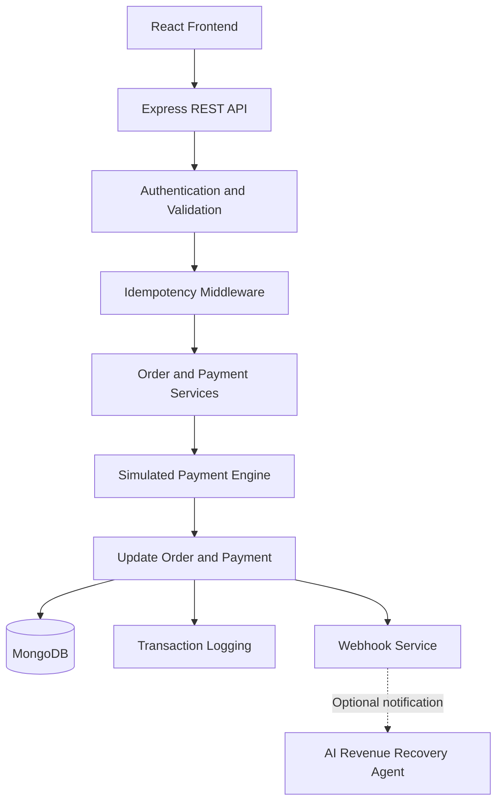

# PayGateway — Payment Processing System

A full-stack **payment processing simulation** built with React, Node.js, Express and MongoDB. It demonstrates payment-system reliability concepts such as idempotency, retries, webhook security, transaction logging and failure handling.

> **Note:** This project simulates payment processing. It does not connect to real banks, Razorpay, Stripe or other financial networks and does not process real money.

## Features

- **Authentication & Authorization:** JWT authentication, bcrypt password hashing and role-based access control (RBAC).
- **Order & Payment Management:** Separate order and payment lifecycles, supporting multiple payment attempts per order.
- **Idempotency:** Request hashing, unique database indexes and cached responses to handle duplicate payment requests.
- **Payment Simulation:** Card, UPI, Net Banking and Wallet payment simulations with configurable outcomes and processing delays.
- **Retry Handling:** Configurable payment attempt limits and order state transitions.
- **Webhook Security:** HMAC-SHA256 signature generation and verification.
- **Transaction Logging:** Persistent logs for payment events, failures and recovery notifications.
- **API Security:** Helmet, CORS, input validation, rate limiting and centralized error handling.
- **Revenue Recovery Integration:** Optional notification of failed payments to an external AI Revenue Recovery Agent.
- **API Documentation & Testing:** Swagger/OpenAPI documentation and automated tests.

## Tech Stack

| Layer | Technologies |
|---|---|
| Frontend | React, Vite, React Router, Axios |
| Backend | Node.js, Express |
| Database | MongoDB, Mongoose |
| Authentication | JWT, bcrypt |
| Security | Helmet, express-validator, HMAC-SHA256, rate limiting |
| Logging | Winston, MongoDB |
| API Documentation | Swagger / OpenAPI |
| Testing | Node.js test runner |

## Architecture



## Payment Processing Flow

1. The user authenticates and creates an order.
2. The checkout submits a payment request with an `Idempotency-Key`.
3. The backend authenticates and validates the request.
4. The idempotency layer checks for duplicate requests.
5. The payment service creates a payment attempt and invokes the simulated gateway.
6. Payment and order statuses are updated based on the outcome.
7. Transaction events are logged, and webhook dispatch is simulated asynchronously.
8. Failed payments can be retried within the configured attempt limit.

## Key Design Decisions

### Separate Orders and Payments

An order represents the payment obligation, while each payment record represents an individual attempt. This preserves payment history across retries.

### Idempotent Requests

Repeated requests with the same key and payload can return a cached response instead of processing the same logical request again. Reusing a key with a different payload results in a conflict.

### Failure Isolation

The optional Revenue Recovery Agent operates independently of the core payment state. A notification failure does not change the recorded payment outcome.

### Configurable Simulation

The payment engine supports configurable success probability, processing delays and deterministic success/failure modes for testing.

## Database Models

- **User:** Account details, password hash and role.
- **Order:** Amount, currency, status, retry count and expiry.
- **Payment:** Payment method, attempt status, gateway response and failure details.
- **IdempotencyKey:** Request hash, processing status, cached response and expiry.
- **TransactionLog:** Payment events, status and operational metadata.

## API Endpoints

| Method | Endpoint | Purpose |
|---|---|---|
| POST | `/api/auth/register` | Register a user |
| POST | `/api/auth/login` | Authenticate a user |
| POST | `/api/orders` | Create an order |
| POST | `/api/payments` | Initiate a payment |
| POST | `/api/payments/retry` | Retry a failed payment |
| GET | `/api/payments/my` | View payment history |
| GET | `/api/payments/:paymentId` | View payment details |
| GET | `/api/payments/admin/all` | Admin payment listing |
| GET | `/api/payments/admin/dashboard` | Admin analytics |
| POST | `/api/webhooks/payment` | Receive and verify webhook payloads |

Protected endpoints require authentication, and administrative endpoints enforce appropriate authorization.

## Environment Variables

Create a `.env` file in the backend directory and configure the required variables.

```env
MONGO_URI=your_mongodb_connection_string
JWT_SECRET=your_jwt_secret

PAYMENT_SUCCESS_RATE=0.85
PAYMENT_MIN_DELAY_MS=500
PAYMENT_MAX_DELAY_MS=3000
PAYMENT_FORCE_OUTCOME=auto

WEBHOOK_SECRET=your_webhook_secret

RECOVERY_AGENT_URL=
RECOVERY_WEBHOOK_SECRET=
RECOVERY_WEBHOOK_TIMEOUT_MS=5000
```

Supported payment outcomes:

- `auto` — Use the configured success probability.
- `success` — Force successful simulated payments.
- `failure` — Force failed simulated payments.

Never commit actual credentials or secrets to version control.

## Installation and Setup

### Prerequisites

- Node.js 20+
- MongoDB instance
- npm

### 1. Clone the Repository

```bash
git clone YOUR_REPOSITORY_URL
cd YOUR_REPOSITORY_NAME
```

### 2. Start the Backend

```bash
cd backend
npm install
npm run dev
```

Configure the backend environment variables before starting the server.

### 3. Start the Frontend

Open a separate terminal:

```bash
cd frontend
npm install
npm run dev
```

The backend defaults to `http://localhost:5000`. The frontend URL and port depend on the Vite configuration.

### 4. Run Tests

```bash
cd backend
npm test
```

## Testing

The payment engine supports deterministic outcomes for testing.

Set `PAYMENT_FORCE_OUTCOME=success` to simulate successful payments or `PAYMENT_FORCE_OUTCOME=failure` to simulate failed payments.

Testing areas include:

- Card masking and hashing.
- Payment simulation.
- Webhook signature generation and verification.
- Malformed webhook payloads and invalid signatures.
- Idempotency and retry scenarios, where covered by the implemented tests.

## Security Measures

- JWT authentication and role-based authorization.
- bcrypt password hashing.
- Request validation and rate limiting.
- Helmet security headers and configurable CORS.
- Card masking and CVV non-persistence.
- HMAC-SHA256 webhook signature verification.
- Idempotency protection against duplicate requests.
- Centralized error handling and transaction logging.

## Current Limitations

- Payment outcomes are simulated; no real money is transferred.
- Card, UPI, bank and wallet integrations are not connected to actual providers.
- Webhook dispatch is simulated rather than implemented through a durable message queue.
- Kafka, Redis and distributed workers should not be considered implemented unless they exist in the current codebase.

## Future Improvements

- Durable asynchronous event processing with Kafka or RabbitMQ.
- Redis-based distributed idempotency and rate limiting.
- Retryable webhook delivery with exponential backoff.
- Metrics, distributed tracing and production monitoring.
- Integration with a real payment provider's sandbox environment.

## Project Summary

PayGateway demonstrates backend engineering concepts used in reliable payment systems, including idempotency, retries, state management, webhook security, audit logging and failure isolation, through a full-stack application.